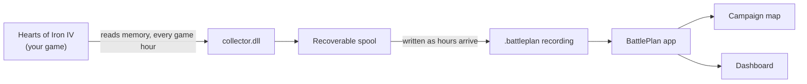

<p align="center">
  
</p>

<h1 align="center">BattlePlan</h1>

<p align="center">Record your Hearts of Iron IV campaigns. Replay every hour of the war.</p>

<p align="center">
  <a href="https://github.com/Simcity400/BattlePlan/releases"><strong>Download</strong></a> ·
  <a href="#record-a-campaign">Record</a> ·
  <a href="#watch-a-replay">Watch</a> ·
  <a href="#mods">Mods</a> ·
  <a href="https://github.com/Simcity400/BattlePlan/issues">Issues</a>
</p>

BattlePlan records your Hearts of Iron IV campaign while you play, then replays it in a Windows desktop app. Scrub to any hour, follow the front on a map drawn the way the game draws it, and dig into a campaign's military, economic and political history in a dashboard you arrange yourself.

## What you get

- **Your whole campaign, hour by hour.** Rewind, pause or fast-forward through every recorded hour.
- **The game's map, redrawn.** Units, fronts, battles, weather, day and night, and over a dozen map modes, from any country's point of view and with its fog of war.
- **A dashboard you build.** Charts, races, tables, timelines and breakdowns for armies, economies, research, diplomacy and more. Tooltips and drill-downs show the detail behind each value.
- **Mod Compatibility.** I can't guarantee that all mods will work but I'm trying hard to make sure they do.
- **Read-only.** The recorder only reads the game. It never pauses, saves or controls it.
- **Open.** Completely free and Open Source. Always 

## Important to Know
- **Performance** When the recorder is running, your game will be slowed down by around 20% when on 5 speed - almost none at all when playing on lower speeds. Weaker PC may not be able to handle this.
- **Storage Space** Typical 1936 - 1948 campaigns are around 1.2GB.
- **Your Content** The replayer relies on content being on your computer. That includes mods, if the content changes ie an update to the game or a mod, you may not be able to playback your recording. Downgrade to a previous version to fix this.
- **This is an Alpha** I am solo developing this so be nice and expect lots of bugs. Pleas also note that **I cannot guarentee your old replay files will always be playable in the future**. At least until I get things into a more stable state.
- **Multiplayer Compatibility** The recorder does work in multiplayer games. Please note that it cannot be played back while recording.

## Install

[Download BattlePlan](https://github.com/Simcity400/BattlePlan/releases) for Windows. Installers appear there once the first build is published; until then, [build from source](#build-from-source). One installer gives you two apps:

- **BattlePlan**: the replay app, with the campaign map and the dashboard.
- **BattlePlan Recorder**: a small tray app that records while you play.

You need:

- Windows, with Microsoft Edge WebView2.
- Hearts of Iron IV. An unrecognised game version shows a warning, and any part that can't verify itself on that version is left out by name.

Updates arrive in the app. Choose the **stable** or **nightly** channel in **Settings**, and a badge shows when a new version is ready to download.

## How it works



1. **Attach.** The recorder finds the running game, checks the version and loads `collector.dll`.
2. **Observe.** Every game hour the collector reads the game's state, and hooks catch events between hours. It only reads.
3. **Write.** Readings are copied out straight away and encoded in the background into a spool file that survives crashes.
4. **Publish.** The recorder writes the indexed, compressed `.battleplan` file as hours arrive and trims the spool as it goes. Stopping finishes the file.
5. **Replay.** The app opens the recording and reads every chart and map hour straight from it.

## Record a campaign

### With BattlePlan Recorder

The replay app starts it for you. You can also run `battleplan-recorder.exe` on its own, or have it start with Windows.

1. Start the game.
2. Click the tray icon, then press **Record**, or turn on automatic recording for this campaign or for every campaign.
3. Play normally. Closing the panel or the replay app doesn't stop recording.
4. Press **Stop**, then **Save** to publish the replay or **Discard** to throw away the current campaign's session. With **Auto save** on, quitting the game saves automatically; otherwise the campaign waits under **Not saved yet**.

Recordings go to `%LOCALAPPDATA%\BattlePlan\captures` by default, which is also the replay app's library. Later sessions of the same campaign continue the same file. Choose **Next time it loads: New file** to start a fresh one.

### With the command line

The command-line recorder, `recorder.exe`, isn't in the installer; [build it from source](#build-from-source).

```powershell
recorder.exe record --once --out <capture folder> --user-dir <Paradox user folder>
```

With `--once`, quitting the game finishes the recording. Without it, the recorder waits for the next game. Press Ctrl+C to stop, or run `recorder.exe detach --out <capture folder>` from another terminal. Use the command line or the tray app, not both.

## Watch a replay

- Under **Campaigns** in the sidebar, press **+** to open a `.battleplan` file. **Archive** lists the other recordings in your library.
- In **Settings > Folders**, choose your game and Paradox user folders.
- Use the playback clock to play, pause, step, change speed and seek. Switch branches under **Map settings > History**. You can line up several recordings at once.
- Press **Edit** to add, move, resize or remove widgets, then **Save** the layout.

Damaged recordings open up to their last intact save point, with a notice about what's missing.

### Campaign map

- Watch from the recording player's point of view or any other country, with fog of war and day and night.
- See units, orders and routes, battle plans, land and naval battles, raids, buildings, resources and weather. Hover for game-style detail windows.
- Map modes include political, terrain, states, factions, players, ideology, resistance, compliance, manpower, infrastructure, diplomacy, operatives, resources, air, navy and raids, plus scripted modes from the recorded mods.
- Use the normal camera or the free **Fly** and **Walk** cameras (F12 switches), with controller support. **Pop out map** opens a second window.
- Game sounds, ambience and music play, with volume controls.
- Export map images from the app, or from the command line:

```powershell
replay-desktop.exe --window-dump <campaign.battleplan> --hour <n> --branch <id> --out <frame.png> --camera <x,z,height>
```

### Dashboard

- **Countries and factions:** scoreboard and game score, army, air and navy strength, factories, territory, fuel, nukes, experience.
- **Economy:** production, equipment designs and stockpiles, losses, construction, trade, resources, lend-lease, market contracts, licences, naval repairs.
- **War:** wars and war goals, casualties, land and naval battles, ships sunk, air losses, bombing, raids, peace deals, territory changes.
- **Politics:** political power, stability and war support, parties and elections, national spirits and focuses, subjects, civil wars, world tension, diplomacy.
- **Research and intelligence:** research, doctrines, special projects, intelligence agencies, operatives, decryption.
- **Units and leaders:** division templates, equipment and training, unit histories, generals, admirals, air aces.

Tooltips and drill-downs show the detail behind each value.

## Mods

- A recording remembers the exact base game, DLC and mod list it was made with, and playback uses that list, not whatever your launcher has selected. Install the same mods for full detail.
- You can pick visual mods for artwork, interface, fonts and models. They change how things look, never the recorded facts.
- A recording carries the game facts it needs (definitions, localisation, executable tables, map layout), read from the game, DLC and mods. It names that content by identity and hash, not by where it's installed, but the content itself is copied as is. Sharing a recording shares that content, including from unpublished mods.
- Recordings from other people are treated as untrusted. Readers check every size and count, and damaged parts become named gaps.

## Diagnostics and recovery

- **Settings > Diagnostics** (or Ctrl+F3) shows map diagnostics.
- The recorder has offline tools:

```powershell
recorder.exe inspect <replay>                                     # identity, branches, hours, gaps, coverage
recorder.exe metrics <replay> <branch> <first hour> <last hour>   # recorded capture timings
recorder.exe sizes <replay> [--json]                              # size by table
recorder.exe derived <replay> --game-dir <game> --user-dir <user> # check playback calculations
```

- If a recording didn't finish cleanly, its session folder is kept. Once the game has exited, `recorder.exe finalize <session folder> --out <capture folder>` recovers the readable part.

## Build from source

```powershell
npm.cmd ci
npm.cmd run dev          # run the desktop app
npm.cmd run build:desktop  # release build
cargo build --release -p recorder -p collector   # command-line recorder and collector.dll
```

## License

BattlePlan is free software under the [MIT License](LICENSE).

This software is based in part on the work of the Independent JPEG Group. It uses the Rust `image` library for several texture formats and includes a modified Rust adaptation of PhysicsFS in the archive reader. The refresh icon is from Lucide. Third-party notices are in [LICENSES](LICENSES/); the installed app carries them combined in `THIRD-PARTY-NOTICES.txt`.

BattlePlan is an unofficial project and is not affiliated with or endorsed by Paradox Interactive. Hearts of Iron IV is a trademark of Paradox Interactive AB. The repository contains no data, assets or code from the game; at run time, the app reads what it needs from your own installation.
