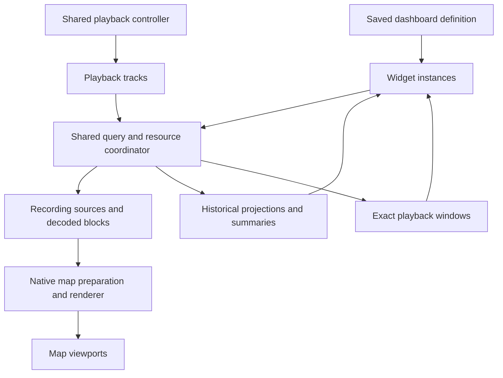

# Analytics dashboard architecture

## Product contract

The dashboard is a library of deliberately designed widgets. Users add, move,
resize and configure those widgets; they do not build arbitrary widgets or write
queries. Each widget can evolve independently through a small, typed contract.

The native map belongs in this library. Several maps may show different cameras,
recordings, branches or reference moments. Maps and statistics read `.battleplan`
files. There is no connection to a running game or recorder.

Whole-campaign analysis and replay playback work at the same time. One shared
play/pause control advances linked views. A widget may instead show the complete
campaign, retain a selected period, or stay at a reference moment. A full-history
chart can retain its data while displaying a moving replay-position marker.

Comparisons may include countries, branches and separate recording files. A
local selection changes its widget; applying a selection to the dashboard is an
explicit action. Country comparisons begin with the recorded countries available
to that query, and selecting a country exposes that country's data.

Ready views appear immediately. A slower view shows its own loading state and
does not block other views. An obsolete result must never be labelled as current.
Layouts and widget configuration can be saved and applied to other recordings.

The initial target is a Windows gaming computer with 16 GB RAM and a modest
dedicated GPU. This is a design target, not a measured minimum specification.
Detailed RAM/GPU tuning follows the prototype, but ownership, budgets and
replaceable data/rendering boundaries are required in the first implementation.

## Starting point

The pre-dashboard implementation provided the shared replay decoder, exact-value
DTOs, historical reduction, native map rendering, background map preparation,
generation checks and a Tauri/React shell. Preserve those correctness rules and
the existing renderer.

The following pre-dashboard constraints explain the ownership changes. These are the starting-point problems, not current endpoint behavior:

| Existing implementation | Consequence for the dashboard |
|---|---|
| `ui/src/api.ts` has a global analytics generation; `crates/desktop/src/analytics_service.rs` cancels all active work on a new request. | Both endpoints need independent request/subscription identities. |
| `crates/analytics/src/scan.rs` scans overlapping blocks for each uncached single-country query. | Batch compatible country/widget demands and retain reusable projections. |
| `crates/analytics/src/reduce.rs` stores first/last/min/max and coverage, discarding intermediate observations. | Historical plot summaries cannot serve arbitrary exact playback hours or arbitrary totals. |
| `crates/viewer/src/app.rs` owns playback inside the native interface; hiding it stops advancement. | Playback lifetime must belong to the dashboard, independently of map visibility. |
| `crates/viewer/src/embedded.rs` reports integer displayed hours at 250 ms intervals. | Requested time, displayed time, fractional presentation and generations need an explicit contract. |
| The viewer and analytics separately read the compressed file; each native hour pipeline creates a pool and a 96-frame cache. | A view must not become another independent owner of file data, workers and large caches. |
| `crates/viewer/src/map/scene.rs` owns resources for a document and its output targets. | Separate compatible content resources from camera-, time- and viewport-dependent resources. |

The upstream calendar picker and component documentation remain the baseline.
Do not reintroduce the retired running project plan or rendering diary.

## Ownership

### Recording source

A source is an opened recording revision, its validated metadata/index and the
ability to read its blocks. It has a source ID scoped to the running application.
Several tracks and widgets reference the same source instead of opening it again.
The file remains the authority; derived data can be discarded and reconstructed.

The source boundary hides its byte backing. It must permit a bounded reader or
read-only mapping without changing widgets or queries. Reading the entire file
into a new private buffer for every view is not the final ownership model.

Source identity includes the recording and its revision. The existing
path/length/modification-time marker is a change detector, not a content hash.
Never treat equal file lengths and timestamps in different files as equal
content. A changed source invalidates its derived results. Requests and results
retain the identity used to compute them; opening a different source cannot
publish the old source's results into its widgets.

### Playback track

A track references a source and branch. It defines how a position on the shared
timeline maps to a recorded hour. Several widgets may follow one track; different
cameras do not require different tracks. A comparison branch or an offset replay
may require another track over the same source.

Use an explicit anchor mapping:

`recorded position = track anchor hour + shared elapsed hours`

Calendar alignment chooses matching calendar anchors. Event-relative comparison
lets the user choose an anchor independently in each recording. This changes the
display alignment, never the timestamps stored in the recording. There is one
play/pause state and speed. A pinned view has no independent running clock.

Out-of-range tracks show their coverage boundary instead of silently borrowing
an endpoint or converting absence to zero. A gap within a valid branch remains a
gap. Do not join branches using probable parentage.

### Widget

A widget owns its presentation, local selections, small view state and settings.
Its definition supplies a stable type/version, defaults, supported time modes,
configuration validation/migration, size limits, data requirements and renderer.
Registering a new widget should not require modifying the dashboard scheduler.

A widget receives source/track references, resolved time scope, result state and
explicit actions. It does not open replay files, own a worker pool, reconstruct
the simulation, maintain an independent playback timer or broadcast local
selections implicitly.

The map uses this same lifetime/configuration contract, while its pixels remain
native. It has its own camera, viewpoint, display options and viewport size.

## Time model

| Mode | Query scope | What playback changes |
|---|---|---|
| Follow replay | Current recorded state, history to the playhead, or a configured trailing interval | The dependent target/result or visible extent |
| Whole campaign | The selected source/branch's complete recorded interval | Optional position marker only |
| Selected period | An explicitly selected interval | Optional position marker only |
| Pinned moment | A particular recorded hour | Nothing until the user changes or relinks it |

Supported modes depend on the widget. A map can follow or pin; a historical chart
can expose history modes. Do not crowd every widget with irrelevant controls.

Keep these values distinct: shared transport position, mapped track position,
requested widget scope, resolved result scope and currently displayed map hour.
Only the transport controller advances time. Rendering may animate a cursor or
the existing permitted division movement between recorded hours, but must not
invent intermediate statistic values.

Use the existing fixed 365-day game-calendar conversion and its 01:00–24:00
display convention. Date-picker drafts do not trigger queries until applied.
Raw signed engine hours remain the underlying values.

## Independent readiness and stale results

Each result carries its source revision, branch, query scope and request
generation. The widget accepts it only if those still match its current demand.
Generation checks are scoped to a widget/subscription, not one global counter.

A seek changes target state immediately and schedules the required work. Ready
widgets publish independently. A pending widget can retain its old image only
with an explicit previous-time/loading indication; it cannot silently show old
values under the new date. Errors, missing data and loading are distinct states.

While playing, prepare upcoming data within the shared budget. A lagging widget
coalesces obsolete demand and rejoins at the current position. It does not force
every other widget to wait or replay an accumulated request backlog. A known
recording gap is a completed unavailable result, not an endless loading state.

A widget failure does not invalidate sibling results. Retry is local. Closing a
source cancels its consumers and releases its resources when no work still owns
them. Shutdown cancels and joins owned work before destroying native resources.

## Data products

### Exact playback data

Keep a bounded window of the required typed projections near each active
playhead. Share a decoded frame when multiple consumers need the same revision,
branch and hour. Once projections and map preparation no longer need a decoded
state, release it. Do not store complete game states for the entire campaign.

Current values come from exact recorded representations. Preserve recorded zero,
missing optional values, absent countries, table failure/truncation, missing
hours and unsupported older-format inputs as different cases. Preserve sample
boundary and cadence information; a carried table value does not acquire a new
observation time merely because another hour is being displayed.

### Historical series

Full-campaign charts are first-class consumers independent of playback. Scan
blocks sequentially, project only requested measurements and retain compact
results. Batch compatible countries and metrics during the same decoded pass.
Use reusable block/range chunks so overlapping views do not restart an entire
campaign scan on every change.

Plot density is a presentation requirement. A chart should request enough points
for its visible width, then request more detail as its range narrows. Reduction
must retain coverage and the information required by that measurement; a gap
must not become a connected line. Historical series stay stable when only their
playback marker moves. Resizing does not discard correct numeric results.

### Range calculations

Totals, averages, rates and cumulative quantities have different definitions.
Each measurement declares its unit, dependencies, exact representation and
valid aggregation. Do not sum a stock level across hours or average averages
without their weights. Derived measurements retain their method and coverage.

Authoritative numbers come from exact inputs or valid aggregations, never from
the reduced points selected for drawing. A prefix calculation at hour H excludes
data after H, including the unfinished part of a summary bucket. Handle partial
range boundaries exactly. A full-range chart and an as-of-playback chart can
reuse underlying historical chunks while having different result scopes.

No general-purpose user query language or database is required for the initial
widget library. A disk cache can later implement the same derived-data boundary
if measurements justify it; its contents must be disposable, versioned and tied
to recording and calculation identity.

## Query coordination and resource limits

Keep one coordinated budget for the application. Sources, tracks and widgets
share it; adding a widget does not grant another pool or cache allowance.

Canonical demand keys include source/revision, branch, measurement definition,
country/entity bindings, time scope and output resolution where relevant. Share
compatible in-flight work and completed results. Track consumers explicitly;
cancel shared work only after no remaining consumer needs it.

Prioritise user actions and current visible playback data, then near-future
preparation, then longer historical work. Historical work needs fair progress
while playback runs. Cooperatively yield at existing safe block/frame boundaries
and bound work in flight. A seek discards obsolete preparation; it must not queue
behind hundreds of no-longer-relevant requests.

Account for bytes, not just counts: compressed backing, inflated block buffers,
typed wire frames, decoder baselines, retained snapshots/projections, results in
transit and graphics resources. Eviction cannot reclaim data still pinned by a
consumer; those pins still count. The file format's maximum block size is not a
reasonable cache budget or evidence of bounded application peak memory.

Under pressure, reduce preparation, discard unused derived results, stop work for
hidden widgets and release inactive map resources. Do not change exact numeric
meaning to fit memory. Work that cannot be admitted waits with a useful status or
reports a resource limit instead of causing unbounded allocation. Initial budget
numbers are implementation defaults to measure, not promises of minimum RAM.

The frontend retains compact view data, not whole decoded game tables. Avoid
serialising entire historical results on every tick. Dispose chart instances,
subscriptions and native views on unmount; preserve only their saved settings.

## Native map boundary

Keep the existing native rendering path. Do not introduce screenshot streaming,
PNG/base64 frames or a second map renderer in the web frontend. Layout messages
carry geometry and identifiers; playback messages carry targets and state.

Multiple map views should share a native graphics device and compatible static
content. Distinguish source/branch/hour preparation from camera-dependent work,
and separate shared texture/geometry assets from each view's uniforms, target
textures, camera and transient state. Different viewpoints may legitimately need
different fog/counter preparation. Share only where all operands match.

The current separate host/viewer processes do not share Rust `Arc`s. The
implementation must identify the real owner of each source/cache. Reusing a
Rust type in both processes does not eliminate duplicate data. Process placement
and native multi-view integration are prototype gates; do not hide an extra
full viewer process behind each widget.

Exercise moving/resizing, viewport clipping, scrolling, menus over map regions,
pointer focus, DPI changes, hidden widgets and shutdown in the actual desktop
host. Browser layout alone cannot establish that native embedding works.

## Frontend and libraries

Retain React/TypeScript, Tauri and native wgpu/egui. The current prototype uses
placeholder panels pending widget design; Apache ECharts was removed with the
unapproved statistics renderers. Use React Grid Layout for drag/resize/packing and saved geometry,
with explicit layout state and an edit mode. Native headers/controls remain
reachable while rearranging map widgets.

Use small typed state modules for dashboard definitions, transport and data
subscriptions. Do not put a high-frequency clock in a context that rerenders the
entire dashboard. Future chart implementations should preserve renderer instances
across data/marker changes and suspend work while inactive.

Primary library references:

- [React Grid Layout API and layout serialization](https://github.com/react-grid-layout/react-grid-layout)

Library choice does not establish application throughput or memory use. Pin the
installed grid version and validate it against the existing React build.

## Saved dashboards

Save a versioned definition containing a name, source/track roles, widget IDs and
types, per-widget configuration versions, geometry, time modes and general
comparison settings. Keep runtime file handles, decoded data, pending requests,
errors and animation state out of it.

Opening a different recording binds the primary source role to the new file.
Additional comparison roles can be rebound explicitly. Resolve countries against
that recording; numeric entity IDs are not portable between files. Tags or
explicit semantic bindings such as selected country/all countries are reusable
intent, not proof of matching identities. Missing bindings display clearly.

Do not silently clamp a saved date range into a different question. Validate
configuration before loading, migrate known versions, preserve unsupported
widgets as unavailable entries, and make a damaged layout recoverable without
affecting the recording. Persist committed edits, not every animation tick.

## Original delivery sequence (superseded)

The sequence below records the initial plan. The current prototype keeps the
query runtime but uses placeholders instead of the statistics widgets in steps
3 and 5; see Implemented prototype boundaries below.

1. Establish typed source/track/time/result contracts and resource ownership.
   Add focused pure tests for identity, time alignment, stale completions,
   cancellation, coverage and layout restoration.
2. Build the dashboard shell with the agreed grid, common widget chrome, edit
   mode, saved layout, source/branch selection and the shared playback strip.
3. Add a history widget and a current-value widget using already recorded
   country measurements. They prove independent query/time bindings; detailed
   production, losses and manpower widget design is later work.
4. Integrate the actual native map as a widget. Exercise two cameras over the
   same source, then a second source or branch. Check the intended data/worker/
   graphics sharing and identify any remaining duplication explicitly.
5. Demonstrate full-campaign history while maps and linked statistics play;
   independent range exploration; pause, seek and relink; ready-first loading;
   missing coverage; and restoring the arrangement against another recording.
6. Run local validation, inspect the desktop development app and measure the
   architectural scaling before claiming the prototype ready.

The first slice proves the architecture and interactions. It does not claim that
every widget exists, that every optimization is complete, or that map/capture
fidelity gates have passed.

## Validation and acceptance

### Implemented prototype boundaries

The prototype uses one native child process for source ownership, analytics and
map rendering. The Tauri process proxies projected results; it does not load a
second replay backing. The source registry is
`crates/viewer/src/dashboard_data.rs`; resumable queries and their reservations
are in `crates/analytics/src/{runtime,source,cache,projection,job,query}.rs`. The transport
fragment contract is in `crates/desktop-protocol/src/dashboard_data.rs`, and the
host admission/assembly proxy is `crates/desktop/src/dashboard_service.rs`.

`crates/viewer/src/dashboard_maps.rs` owns map-view admission and lifetimes.
The embedded fullscreen map and dashboard use one `hours::Resources`, with
shared same-source decoding and same-content weather reconstruction. Verified
CPU content can be reused when the retained fullscreen map and a dashboard view
have the same source and resolver configuration. Each map still owns its mutable
Scene and graphics targets. Queued, running and cancelled scene builds retain
their admission permits until their work is destroyed; dropping a widget's
receiver does not release that capacity early.

The default prototype limits are 1 GiB for admitted compressed source backing,
64 MiB for retained Rust query results, 64 MiB for reusable country projections,
16 MiB per query result and a 512 MiB
admitted decompressed block. The frontend uses a 64 MiB estimated result
allowance including active consumers and a 16 MiB idle-cache allowance. Native
dashboard admission allows four resident/building maps and 8 Mi aggregate target
pixels by default. These limits cover different owners and are **not additive
claims of total process memory**. Typed block parsing, allocator overhead,
decoder state, serialization/JS expansion and graphics allocations have separate
costs. The retained fullscreen map also owns its own Scene.

Whole-block decompression/parsing remains indivisible. The selected retained
recording's first block is 467,478,408 decompressed bytes; a 256 MiB ceiling would
reject this ordinary workload. The 512 MiB prototype ceiling admits it, but does
not solve the temporary-memory cost of the existing block representation. A
streamed or shared decoded-block implementation belongs behind the source/query
boundary, with format validation and exact baseline rules preserved.

Identical normalized demands share in-flight work and completed results.
Validated country-table prefixes also serve different country sets, covered
ranges and plot resolutions without another replay decode. Those projections
have their own byte allowance, including chunks held by active scans. Cache
pressure falls back to decoding; it never changes numerical meaning. Concurrent
cold scans and requests beyond a cached prefix can still repeat decoding.
Immutable GPU assets still duplicate between Scenes. Further decoding and GPU
sharing belong behind these existing boundaries.

The frontend implementation starts at `ui/src/dashboard/Dashboard.tsx`.
`definitions.ts` registers widget capabilities and configuration versions;
`queryStore.ts` owns transport-independent demand, admission and result state.
Pure frontend tests cover source/time bindings, saved widget versions, shared
cancellation, stale replies, independent readiness and result pressure.
`client.ts` is its native-independent interface; `nativeClient.ts` adapts that
interface to the wire protocol. The current visual prototype keeps the campaign
map and empty placeholder panels; the earlier current-value and history
renderers have been removed pending widget design. The exact-window and history
query framework remains available for those future widgets. Source catalogues are
observations, not a guaranteed census of every country throughout the campaign.
Acquisition-time provenance unavailable from the decoder is explicitly unknown.

### Checks

Use the checks in [AGENTS.md](../AGENTS.md): workspace build/tests/strict Clippy/
fmt, frontend typecheck/build and generated-type verification. Use existing pure
test patterns, not a new integration/corpus framework. Native changes also need
the applicable existing recorder/viewer smoke and oracle workflow before a
production integration claim; coordinate game ownership and report unrun checks.

For the prototype, inspect actual desktop interactions and retain local results
outside Git. Record replay identities, widget/view counts, display sizes and
hardware so comparisons have a defined workload.

Measure process working/private memory, owned CPU workers, frame/interaction
latency, first-history latency, cached seeks, work in flight and query/cache
reuse. GPU allocation estimates need to distinguish application-owned resources
from driver memory. The reported approximately 4.8 GB existing usage is a user
observation, not an independently reproduced baseline.

Adding a second same-source view must not reopen that source or allocate another
uncontrolled compute pool. Showing a whole-history marker must not start a fresh
history scan. Removing views must release their unique resources. A slow or
failed widget must not hold back ready siblings. Late results, missing hours and
out-of-range tracks must not appear as current recorded values. These are
architectural acceptance conditions; exact performance targets follow measured
prototype behaviour on the target class of computer.
