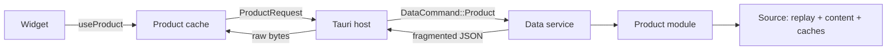

# Dashboard architecture

How the desktop app turns a recording into widgets. Component details live beside the code: [dashboard crate](../crates/dashboard/README.md), [desktop host](../crates/desktop/README.md), [viewer](../crates/viewer/README.md), [frontend](../ui/README.md) and [widgets](../ui/src/widgets/README.md).

## Crates

| Group | Crates | Role |
|---|---|---|
| Capture | collector, recorder | Read the running game and write recordings. |
| Format | replay | The `.battleplan` file, shared by every writer and reader. |
| Game knowledge | engine, installed-content | Memory layouts of the game, and its installed content. |
| Map | viewer | The native renderer process. |
| App | dashboard, desktop, ui | Widget data products and the native data service, the Tauri host, the React interface. |

The viewer executable hosts both the map and the dashboard data service, so a recording is opened once and shared by maps and widgets. The desktop host is the only crate that links Tauri.

## Data flow

A product is one Rust module: typed parameters, one typed reply covering a whole branch, and a per-source cache. The service, transport, host and frontend route by the product's key and never name it. The frontend parses each reply once and resolves the playback hour locally, so widgets update every hour without a request.

## Identity and time

A source is an opened recording revision; several leases, maps and widgets share it. Every reply echoes the lease and revision it answers, and a changed file invalidates everything derived from it. Tracks map the shared clock to a recorded hour per recording. A widget follows playback, holds its branch end, or pins a moment; only the clock advances time, and nothing invents values between recorded hours or across gaps.

## Limits

Requests are admitted, fragmented and cancellable at every step. One reply is at most 32 MiB; the service keeps at most 64 MiB serialized in flight; the frontend cache holds 64 MiB of replies per client. Product caches are per source and evicted with it. These bound the data path, not total process memory or GPU use.

## Checks

Run the commands in [AGENTS.md](../AGENTS.md). Frontend tests are pure node tests; Rust tests use synthetic replays. Native map embedding, throughput and memory still need the desktop host exercised on a real recording before a claim about them.
