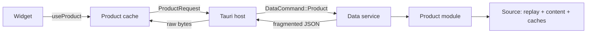

# Dashboard architecture

How the desktop app turns a recording into widgets. Component details live beside the code: [dashboard crate](../crates/dashboard/README.md), [desktop host](../crates/desktop/README.md), [viewer](../crates/viewer/README.md), [frontend](../ui/README.md) and [widgets](../ui/src/widgets/README.md).

## Crates

| Group | Crates | Role |
|---|---|---|
| Capture | collector, recorder | Read the running game and write recordings. |
| Format | replay | The `.battleplan` file, shared by every writer and reader. |
| Game knowledge | engine, installed-content | Memory layouts of the game, and its installed content. |
| Map | viewer | The native renderer process. |
| App | dashboard, desktop, ui | Widget data products and the native data service, the Tauri host, the React interface. |

The viewer executable hosts both the map and the dashboard data service, so a recording is opened once and shared by maps and widgets. The desktop host is the only crate that links Tauri.

## Data flow

A product is one Rust module with typed parameters, a typed reply and optional per-source state. History products cover a whole branch, so playback resolves their values locally. Hour-specific artwork and formula details use separate requests; the frontend's transient path keeps these out of the history cache. The service and host route generic product requests by key; widgets and their data helpers choose the product. The frontend parses each reply once.

## Identity and time

A source is an opened recording revision; several leases, maps and widgets share it. Product replies echo the lease, revision and product key they answer. A changed revision uses a separate source and caches; opening with an outdated expected revision is refused. Tracks map the shared clock to a recorded hour per recording. A widget follows playback, holds its branch end, or pins a moment. History products preserve gaps and distinguish sampled values from carried daily inputs.

## Limits

Requests are admitted and cancellable; replies are fragmented. One reply is at most 32 MiB; the service keeps at most 64 MiB serialized in flight. The frontend history cache evicts settled replies above 128 entries or an estimated 64 MiB per client (twice the JSON string length). Product state is per source and evicted with it. These limits do not bound total process memory or GPU use.

## Checks

From the repository root, run `cargo test -p dashboard -p replay-desktop`, `npm.cmd run check:ui` and `npm.cmd run test:ui` for affected changes. Frontend tests are pure node tests; Rust tests use synthetic replays. Native map embedding, throughput and memory still need the desktop host exercised on a real recording before a claim about them.
